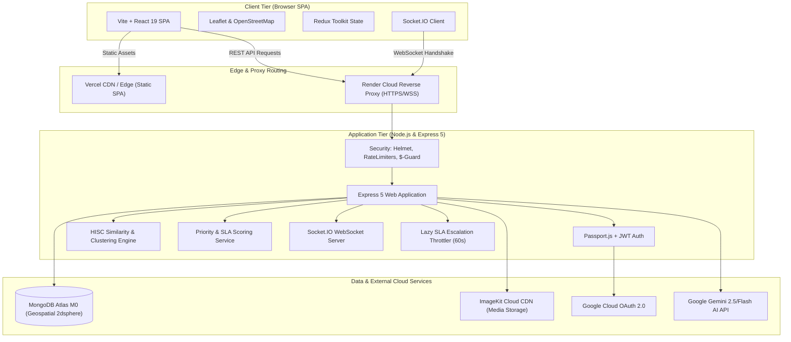
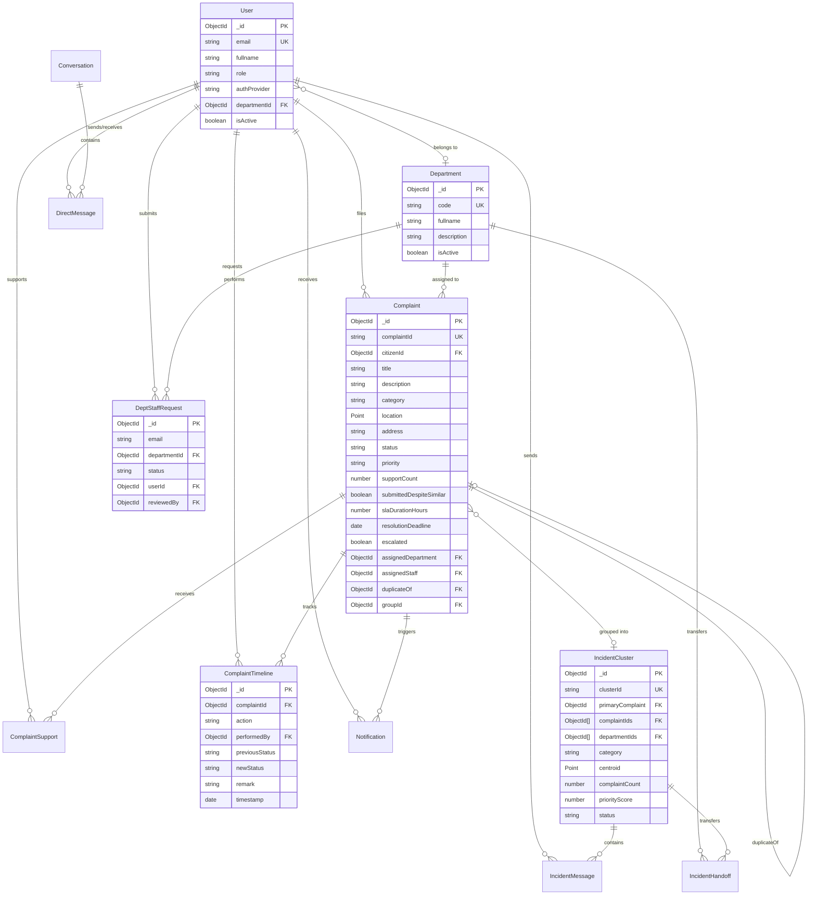
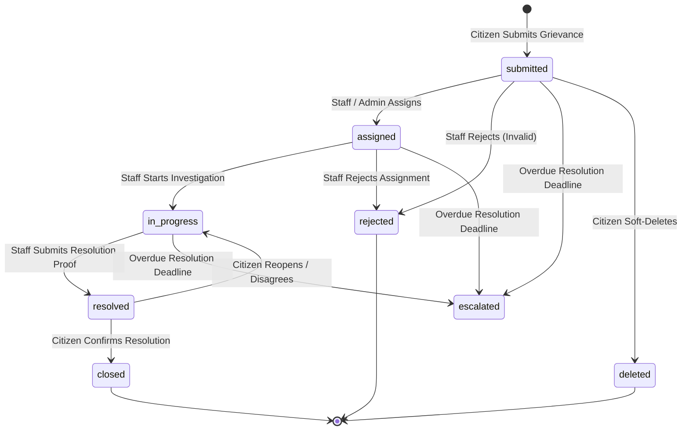
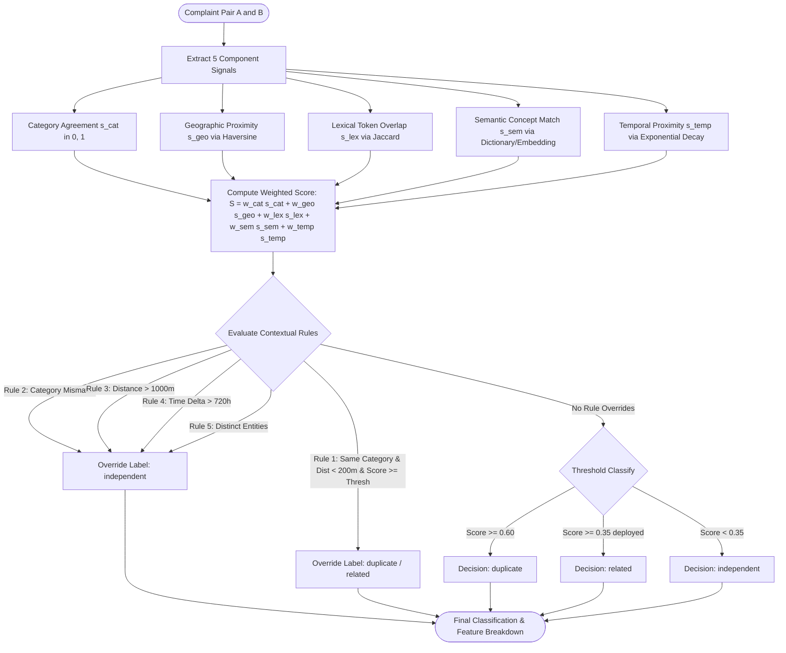
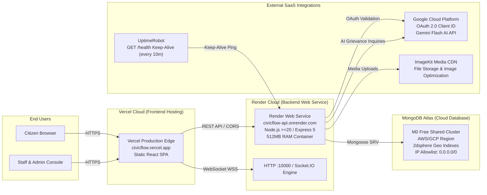
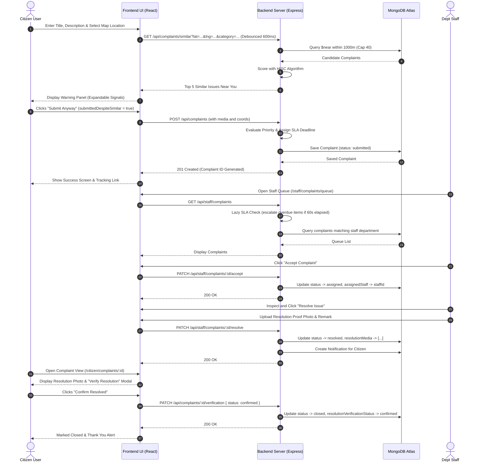

# CivicFlow Architectural & Workflow Diagrams

This document contains Mermaid diagrams detailing CivicFlow's system architecture, entity relationships, lifecycle state machines, scoring algorithms, deployment topology, and operational sequences.

---

## 1. System Architecture Diagram

---

## 2. Entity-Relationship (ER) Diagram

---

## 3. Complaint Lifecycle State Machine

---

## 4. HISC Similarity Scoring & Contextual Rules Flowchart

---

## 5. Deployment Topology Diagram

---

## 6. Citizen-to-Resolution Operational Sequence

